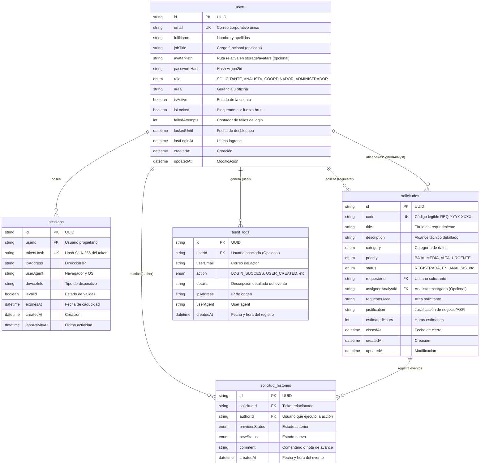

# Modelo de Datos y PostgreSQL - Plataforma BNB

El modelo de datos relacional está optimizado para garantizar integridad referencial, trazabilidad de auditoría bancaria y alto rendimiento en consultas filtradas.

---

## 1. Diagrama Entidad-Relación (ERD)



---

## 2. Descripción de Tablas

### `users`
Almacena las credenciales y perfiles de los funcionarios del banco:
* `email`: Índice único en minúsculas.
* `passwordHash`: Almacenado con el algoritmo Argon2id.
* `failedAttempts`, `isLocked`, `lockedUntil`: Controlan el bloqueo por fuerza bruta.

### `sessions`
Registra las sesiones revocables activas:
* `tokenHash`: Índice único para validación rápida en cada petición autenticada.
* `isValid`: Bandera que permite la invalidación instantánea sin eliminar el registro histórico.

### `solicitudes`
Entidad principal del ciclo de vida de requerimientos analíticos:
* `code`: Código único consecutivo anual (ej. `REQ-2026-0001`).
* `assignedAnalystId`: Llave foránea hacia `users` restringida por regla de negocio a roles no-solicitantes.
* `closedAt`: Marca de tiempo registrada automáticamente cuando el ticket pasa a `APROBADA`, `RECHAZADA` o `CANCELADA`.

### `solicitud_histories`
Bitácora inmutable de eventos por solicitud:
* Cada cambio de estado o comentario registrado por el solicitante o analista se inserta con clave foránea en cascada ante eliminación del ticket.

### `audit_logs`
Bitácora de seguridad para auditorías internas del banco:
* Registra inicios de sesión exitosos y fallidos, bloqueos de cuenta, creación y edición de usuarios, y cambios de estado en requerimientos.

---

## 3. Enumeradores (Enums)

- **`Role`:** `SOLICITANTE`, `ANALISTA`, `COORDINADOR`, `ADMINISTRADOR`.
- **`RequestStatus`:** `REGISTRADA`, `EN_ANALISIS`, `EN_REVISION_COORDINACION`, `APROBADA`, `RECHAZADA`, `CANCELADA`.
- **`RequestPriority`:** `BAJA`, `MEDIA`, `ALTA`, `URGENTE`.
- **`RequestCategory`:** `EXTRACCION_DATOS`, `REPORTES_BI`, `MODELOS_ML`, `CALIDAD_DATOS`, `GOBIERNO_DATOS`, `ACCESO_BD`.
- **`AuditAction`:** `LOGIN_SUCCESS`, `LOGIN_FAILED`, `ACCOUNT_LOCKED`, `LOGOUT`, `SESSION_REVOKED`, `REQUEST_CREATED`, `REQUEST_STATUS_UPDATED`, `USER_CREATED`, `USER_UPDATED`.

---

## 4. Comandos de Gestión de Base de Datos

```bash
# Validar el esquema de Prisma sin conexión activa
pnpm --filter @bnb/api prisma validate

# Generar el cliente TypeScript de Prisma (@prisma/client)
pnpm --filter @bnb/api prisma generate

# Sincronizar el esquema con PostgreSQL local
pnpm --filter @bnb/api prisma db push

# Poblar la base de datos con usuarios y tickets de prueba
pnpm seed
```

