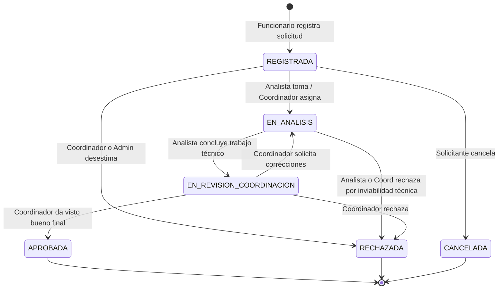

# Control de Acceso Basado en Roles (RBAC) y Seguridad

## 1. Perfiles de Usuario y Matriz de Permisos

| Capacidad / Módulo | SOLICITANTE | ANALISTA | COORDINADOR | ADMINISTRADOR |
| :--- | :---: | :---: | :---: | :---: |
| Iniciar sesión con Argon2id | ✅ | ✅ | ✅ | ✅ |
| Consultar propio perfil y cambiar contraseña | ✅ | ✅ | ✅ | ✅ |
| Monitorear y revocar propias sesiones activas | ✅ | ✅ | ✅ | ✅ |
| Registrar nueva solicitud | ✅ | ✅ | ✅ | ✅ |
| Consultar solicitudes propias | ✅ | ✅ | ✅ | ✅ |
| Consultar solicitudes de toda la gerencia | ❌ | ✅ | ✅ | ✅ |
| Ver detalle y bitácora de tickets propios | ✅ | ✅ | ✅ | ✅ |
| Ver detalle y bitácora de cualquier ticket | ❌ | ✅ | ✅ | ✅ |
| Publicar comentarios y notas de avance | ✅ | ✅ | ✅ | ✅ |
| Asignar o reasignar analista/encargado | ❌ | ❌ | ✅ | ✅ |
| Tomar ticket sin asignar (pasar a análisis) | ❌ | ✅ | ✅ | ✅ |
| Remitir trabajo a revisión de coordinación | ❌ | ✅ | ✅ | ✅ |
| Aprobar formalmente requerimiento (`APROBADA`) | ❌ | ❌ | ✅ | ✅ |
| Rechazar requerimiento con justificación | ❌ | ✅ | ✅ | ✅ |
| Cancelar solicitud (`REGISTRADA`) | ✅ | ❌ | ❌ | ✅ |
| Acceder a la vista Tablero Kanban | ✅ | ✅ | ✅ | ✅ |
| Crear y dar de alta nuevos usuarios | ❌ | ❌ | ❌ | ✅ |
| Activar / desactivar cuentas de usuario | ❌ | ❌ | ❌ | ✅ |
| Desbloquear cuentas bloqueadas por fuerza bruta | ❌ | ❌ | ❌ | ✅ |
| Revocar sesiones de otros usuarios | ❌ | ❌ | ❌ | ✅ |
| Consultar bitácora general de auditoría de seguridad | ❌ | ❌ | ❌ | ✅ |

---

## 2. Regla Bancaria de Asignación de Encargados

Un requerimiento de datos solo puede ser asignado a personal capacitado para su resolución técnica o supervisión directa:

> **Regla de Asignación:** Un Coordinador o Administrador puede asignar como encargado del ticket a cualquier usuario del sistema **excepto a aquellos que posean el rol de `SOLICITANTE`**.

### Aplicación técnica:
1. **Endpoint de Filtrado (`GET /api/v1/users/assignable`):**
   Excluye a nivel de consulta SQL a todos los usuarios con `role = 'SOLICITANTE'` o `isActive = false`.
2. **Validación en Controlador y Servicio (`PATCH /api/v1/solicitudes/:id/assign`):**
   Si se envía el identificador de un usuario con rol `SOLICITANTE`, la petición es rechazada de inmediato con:
   ```json
   {
     "success": false,
     "error": {
       "statusCode": 400,
       "code": "Bad Request",
       "message": "Regla de asignación: No se puede asignar un requerimiento a un usuario con rol SOLICITANTE. Debe asignarse a un Analista, Coordinador o Administrador."
     }
   }
   ```

---

## 3. Matriz de Transiciones de Estados

El ciclo de vida del ticket se controla estrictamente mediante la máquina de estados definida en `@bnb/shared`:



### Tabla Exhaustiva de Transiciones Permitidas:

| Estado Actual | SOLICITANTE | ANALISTA | COORDINADOR | ADMINISTRADOR |
| :--- | :--- | :--- | :--- | :--- |
| **REGISTRADA** | `CANCELADA` | `EN_ANALISIS` | `EN_ANALISIS`, `RECHAZADA` | `EN_ANALISIS`, `RECHAZADA`, `CANCELADA` |
| **EN_ANALISIS** | *(Ninguna)* | `EN_REVISION_COORDINACION`, `RECHAZADA` | `EN_REVISION_COORDINACION`, `RECHAZADA` | `EN_REVISION_COORDINACION`, `RECHAZADA`, `CANCELADA` |
| **EN_REVISION_COORDINACION** | *(Ninguna)* | *(Ninguna)* | `APROBADA`, `EN_ANALISIS`, `RECHAZADA` | `APROBADA`, `EN_ANALISIS`, `RECHAZADA` |
| **APROBADA** | *(Cerrado)* | *(Cerrado)* | *(Cerrado)* | `EN_REVISION_COORDINACION` *(Reapertura técnica)* |
| **RECHAZADA** | *(Cerrado)* | *(Cerrado)* | *(Cerrado)* | `REGISTRADA` *(Reactivación admin)* |
| **CANCELADA** | *(Cerrado)* | *(Cerrado)* | *(Cerrado)* | `REGISTRADA` *(Reactivación admin)* |

Cualquier intento de saltarse la matriz es interceptado por `SolicitudesService`, retornando una excepción `403 Forbidden` que detalla los estados válidos permitidos para el rol.
